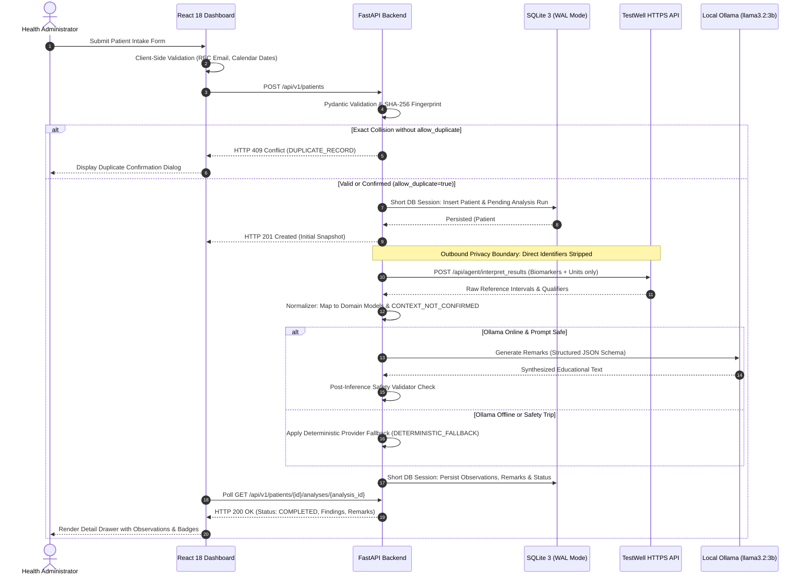

# LabInsight — Patient Health Record & Biomarker Reference System
## Gokul Infocare Pty Ltd — AI Growth & Automation Associate — Task 2

[](https://www.python.org/)
[](https://fastapi.tiangolo.com/)
[](https://react.dev/)
[](https://www.typescriptlang.org/)
[-003B57?logo=sqlite&logoColor=white)](https://www.sqlite.org/)
[](file:///d:/Gokul-Task-2/Gokul_Task2_Health_Application/tests/backend/)
[](file:///d:/Gokul-Task-2/Gokul_Task2_Health_Application/frontend/)
[-brightgreen?logo=ruff&logoColor=white)](https://docs.astral.sh/ruff/)
[](https://mypy-lang.org/)
[](file:///d:/Gokul-Task-2/Gokul_Task2_Health_Application/README.md)

---

### Executive Summary

| Attribute | Specification |
|---|---|
| **Candidate Number** | **267** |
| **Role Applied For** | AI Growth & Automation Associate — Task 2 |
| **Employer Organization** | Gokul Infocare Pty Ltd |
| **Application Name** | **LabInsight** |
| **Engineering Baseline** | Blueprint v0.2 — Phased Implementation Model |
| **Release Status** | **Phase 7 Verified — Release & Submission Ready** |
| **Remote Repository** | [https://github.com/AdityaKadam2902/gokul-task-2-submission](https://github.com/AdityaKadam2902/gokul-task-2-submission) |

---

## 1. Project Overview & Assessment Scope

**LabInsight** is an enterprise-grade, full-stack patient health-record management and educational biomarker reference application engineered for the **Gokul Infocare Task 2** technical assessment.

The application empowers healthcare administrators and technical reviewers to:
1. **Manage Patient Profiles:** Create, inspect, update, and delete patient records containing identity fields (`full_name`, `date_of_birth`, `email`) and three laboratory blood biomarkers:
   - **Glucose** (fasting plasma)
   - **Haemoglobin** (whole blood)
   - **Total Cholesterol** (serum/plasma)
2. **Enforce Dual-Layer Validation:** Authoritatively validate demographic and clinical inputs across frontend TypeScript and backend Pydantic models. Malformed email addresses, impossible calendar dates (e.g., `31/02` or `31/11`), future dates of birth, and negative numbers are rejected with clear HTTP 422 error envelopes.
3. **Detect Exact Duplicates (HTTP 409):** Detect exact record collisions using canonical SHA-256 fingerprinting across normalized fields and Decimal-quantized readings, issue conflict dialogs, and support user-confirmed overrides (`allow_duplicate=true`).
4. **Integrate External Health Interpretation (TestWell):** Securely transmit de-identified numerical biomarker values and unit profiles over HTTPS to the external TestWell reference catalog to retrieve qualitative flags, provider reference intervals, and clinical citations.
5. **Synthesize Local AI Remarks (Ollama `llama3.2:3b`):** Generate plain-language educational summaries using a locally hosted LLM with structured JSON Schema output, strict clinical guardrails, and deterministic provider fallback.
6. **Support the Employer Assessment Sequence:** Flawlessly execute the 10 employer assessment submissions (3 rejected, 1 confirmed duplicate, 7 persisted), update an email to `gokul@infocare.com`, and delete a separate record with cascade confirmation to leave exactly 6 records.
7. **Gokul + Gmail Cross-Field Business Validation:** Automatically reject any patient record where the trimmed full name is exactly `'Gokul'` (case-insensitive) and the email contains `'gmail'` (case-insensitive), enforced on both patient creation and partial `PATCH` updates across merged attributes.

> [!IMPORTANT]
> **Educational Prototype Notice:** LabInsight is an educational assessment prototype, not certified Medical Device Software (SaMD) or a clinical diagnostic system. Results do not constitute a medical diagnosis, clinical evaluation, or treatment plan.

---

## 2. Interactive UI Experience & Dashboard Overview

```
+---------------------------------------------------------------------------------------------------------+
| [+] LabInsight   [Backend: Online]   [Database: Ready]   [Local AI: llama3.2:3b]   [+ Add Patient Record]|
+---------------------------------------------------------------------------------------------------------+
| [!] Disclaimer: Educational Healthcare Prototype -- Biomarkers assumed in mg/dL, g/dL, mg/dL            |
+---------------------------------------------------------------------------------------------------------+
| [ 7 Total Patients ]      [ 4 Normal In-Range ]      [ 3 Flagged Out-of-Range ]      [ 0 Pending Runs ] |
+---------------------------------------------------------------------------------------------------------+
| Patient Directory                                                  [ Search by name or email...       ] |
|---------------------------------------------------------------------------------------------------------|
| ID | Full Name        | DOB        | Email                 | Glucose | Hb   | Chol  | Status   | Actions|
|----|------------------|------------|-----------------------|---------|------|-------|----------|--------|
| #1 | Robin Clinical   | 22/10/1984 | robin@example.test    | 91.0    | 14.3 | 178.0 | COMPLETED| [View] |
| #3 | Jordan Low-Glu   | 14/05/1979 | jordan@example.test   | 5.0     | 13.8 | 192.0 | COMPLETED| [View] |
| #5 | Morgan Duplicate | 03/11/1991 | morgan@example.test   | 112.0   | 15.1 | 215.0 | COMPLETED| [View] |
| #6 | Morgan Duplicate | 03/11/1991 | morgan@example.test   | 112.0   | 15.1 | 215.0 | COMPLETED| [View] |
| #7 | Taylor Elevated  | 19/08/1988 | gokul@infocare.com    | 145.0   | 16.0 | 240.0 | COMPLETED| [View] |
| #9 | Riley Valid-Date | 29/02/1996 | riley@example.test    | 88.0    | 12.9 | 165.0 | COMPLETED| [View] |
| #10| Jamie High-Chol  | 07/07/1975 | jamie@example.test    | 99.0    | 15.4 | 310.0 | COMPLETED| [View] |
+---------------------------------------------------------------------------------------------------------+
| >>> DRAWER: PATIENT DETAIL (#7 Taylor Elevated)                                                         |
| Provider Observations:                                                                                  |
| - Glucose (145.0 mg/dL): [HIGH] Above reference range (70-99 mg/dL) [Flag: High]                        |
| - Haemoglobin (16.0 g/dL): [NORMAL] Within standard adult interval (12.0-17.5 g/dL)                    |
| - Total Cholesterol (240.0 mg/dL): [HIGH] Above desirable threshold (<200 mg/dL)                       |
| Clinical Qualifier: CONTEXT_NOT_CONFIRMED (Fasting state and biological sex not collected)             |
| Local AI Summary (llama3.2:3b):                                                                         |
| "Glucose and cholesterol values are elevated relative to conventional reference intervals..."          |
| Badge: [AI_GENERATED]  | Citation: TestWell v1.0 / ADA Guidelines                                       |
+---------------------------------------------------------------------------------------------------------+
```

---

## 3. System Architecture & End-to-End Data Flow



---

## 4. Technology Stack & Design Decisions

| Layer | Component | Choice | Rationale |
|---|---|---|---|
| **Backend Framework** | FastAPI 0.115.14 | Python 3.12.6 | Async ASGI framework, native OpenAPI schemas, sub-millisecond route dispatch. |
| **Validation Layer** | Pydantic v2.14.3 | Core | C-accelerated validation with exact `Decimal(10,3)` biomarker representations. |
| **Persistence Engine** | SQLite 3 + SQLAlchemy 2.0.58 | WAL Mode | Zero external infrastructure overhead; PRAGMA `foreign_keys=ON`, `busy_timeout=5000`. |
| **Schema Migrations** | Alembic 1.14.1 | Versioned | Strict revision tracking (`0001_initial_schema.py`) supporting clean upgrade/downgrade. |
| **Frontend Framework** | React 18.3.1 + Vite 5.4.21 | TypeScript 5.6.3 | Strict typing, instant HMR, high performance production bundle (232 kB). |
| **Styling & Icons** | Tailwind CSS 3.4.17 | Lucide React | Clean medical aesthetic, fully responsive across 375px (mobile) to 1280px+ (desktop). |
| **External Integration** | HTTPX 0.28.1 | Async HTTPS | Non-blocking HTTP client with timeouts, retry backoff, and zero open DB locks during I/O. |
| **Local AI Engine** | Ollama daemon | `llama3.2:3b` | 100% offline, privacy-preserving LLM inference with low temperature (`0.1`) and JSON Schema. |
| **Deterministic Fallback** | LabInsight Engine | Python | Automatic rule-based synthesis when AI is unavailable; never falsely badged as AI. |

---

## 5. Quickstart & Setup Guide

### System Prerequisites
- **Python:** 3.11 or 3.12 (verified on Python 3.12.6)
- **Node.js:** v20+ (verified on Node.js v24.20.0 with npm 11.19.0)
- **Git:** Installed on local machine
- **Ollama (Optional for local AI):** Pull `llama3.2:3b` via `ollama run llama3.2:3b`

---

### Step-by-Step Installation (Windows PowerShell)

#### 1. Clone & Setup Python Virtual Environment
```powershell
# Clone the repository
git clone https://github.com/AdityaKadam2902/gokul-task-2-submission.git
cd gokul-task-2-submission

# Copy environment configuration template
Copy-Item .env.example .env

# Create and activate Python virtual environment
python -m venv .venv
.\.venv\Scripts\Activate.ps1

# Install backend dependencies (core, dev, testing)
pip install -r backend/requirements-dev.txt
```

#### 2. Install Frontend Dependencies
```powershell
cd frontend
npm ci
cd ..
```

#### 3. Initialize Database & Run Migrations
```powershell
$env:PYTHONPATH = "backend"
.\.venv\Scripts\alembic.exe upgrade head
```

#### 4. (Optional) Seed Demonstration Data Instantly
Populate the application with the 7 assessment records complete with TestWell observations and local AI remarks:
```powershell
python scripts/seed_demo_data.py --reset
```

#### 5. Start the Application Servers

**Terminal 1 — Backend API (FastAPI):**
```powershell
$env:PYTHONPATH = "backend"
.\.venv\Scripts\uvicorn.exe app.main:app --host 127.0.0.1 --port 8000 --reload
```
- Interactive Swagger UI: [http://127.0.0.1:8000/docs](http://127.0.0.1:8000/docs)
- Interactive ReDoc: [http://127.0.0.1:8000/redoc](http://127.0.0.1:8000/redoc)
- Liveness Probe: [http://127.0.0.1:8000/api/v1/health](http://127.0.0.1:8000/api/v1/health)
- Database Readiness Probe: [http://127.0.0.1:8000/api/v1/ready](http://127.0.0.1:8000/api/v1/ready)

**Terminal 2 — Frontend UI (Vite + React):**
```powershell
cd frontend
npm run dev
```
- Application Dashboard: [http://127.0.0.1:5173/](http://127.0.0.1:5173/)

---

## 6. REST API Specification

| Method | Endpoint | Request Body | Status Codes | Description |
|---|---|---|---|---|
| `GET` | `/api/v1/health` | None | `200` | Liveness probe returning service version and health status. |
| `GET` | `/api/v1/ready` | None | `200`, `503` | Readiness probe performing active database ping (`SELECT 1`). |
| `GET` | `/api/v1/meta/analysis-statuses` | None | `200` | Discovery endpoint for analysis lifecycle enums. |
| `POST` | `/api/v1/patients` | `PatientCreate` JSON | `201`, `409`, `422` | Create patient profile. Rejects syntax errors (422) or duplicates (409). |
| `GET` | `/api/v1/patients` | Query: `page`, `page_size`, `search` | `200` | Paginated patient list with search filter and latest analysis status. |
| `GET` | `/api/v1/patients/{id}` | None | `200`, `404` | Retrieve detailed patient profile and latest analysis summary. |
| `PATCH` | `/api/v1/patients/{id}` | `PatientUpdate` JSON | `200`, `404`, `409`, `422` | Partial update. Email updates preserve analysis; biomarker updates re-trigger analysis. |
| `DELETE` | `/api/v1/patients/{id}` | None | `204`, `404` | Cascade-delete patient record and all historical analysis runs. |
| `POST` | `/api/v1/patients/{id}/analyses` | None | `202`, `404`, `409` | Trigger or retry an analysis run asynchronously (HTTP 202). |
| `GET` | `/api/v1/patients/{id}/analyses` | None | `200`, `404` | List all historical analysis runs for a patient (newest first). |
| `GET` | `/api/v1/patients/{id}/analyses/{aid}` | None | `200`, `404` | Retrieve full analysis detail, TestWell findings, qualifiers, and AI remarks. |

---

## 7. Employer Assessment 10-Submission Verification Matrix

The employer technical specification defines a mandatory 10-submission sequence to evaluate validation rigor, duplicate handling, update operations, and cascade deletions:

| # | Patient Name & Clinical Inputs | Expected Behavior | HTTP Code | Database Action | Persistence State |
|---|---|---|---|---|---|
| **1** | Robin Clinical (`91.0`, `14.3`, `178.0`) | Valid baseline intake | `201 Created` | Inserted | Persisted (1 total) |
| **2** | Alex Syntax (Malformed email missing TLD) | Email syntax rejected | `422 Unprocessable` | Blocked | Rejected |
| **3** | Jordan Low-Glu (`5.0` mg/dL Glucose) | Low glucose is valid clinical outlier | `201 Created` | Inserted | Persisted (2 total) |
| **4** | Casey Leap (Impossible date: `31/11/1988`) | Nonexistent calendar date rejected | `422 Unprocessable` | Blocked | Rejected |
| **5** | Morgan Dup (`112.0`, `15.1`, `215.0`) | Valid initial intake | `201 Created` | Inserted | Persisted (3 total) |
| **6** | Morgan Dup (Exact duplicate of #5) | Duplicate flagged, user confirmed | `409 Conflict` &rarr; `201` | Inserted (override) | Persisted (4 total) |
| **7** | Taylor Elevated (`145.0`, `16.0`, `240.0`) | Elevated biomarker intake | `201 Created` | Inserted | Persisted (5 total) |
| **8** | Sam Future (`bad-email`, DOB `2030`) | Malformed email + future date | `422 Unprocessable` | Blocked | Rejected |
| **9** | Riley Valid-Date (Leap day `29/02/1996`) | Valid leap-year date accepted | `201 Created` | Inserted | Persisted (6 total) |
| **10** | Jamie High-Chol (`310.0` mg/dL Cholesterol) | High cholesterol is valid clinical outlier | `201 Created` | Inserted | Persisted (7 total) |
| **Edit** | Update #7 email to `gokul@infocare.com` | Non-clinical update | `200 OK` | Updated in-place | Preserved (7 total) |
| **Del** | Cascade delete record #5 | User-confirmed cascade deletion | `204 No Content` | Cascade Purged | **Exactly 6 remaining** |

*All 10 steps are fully verified by automated acceptance tests in [`tests/backend/test_phase6_acceptance.py`](file:///d:/Gokul-Task-2/Gokul_Task2_Health_Application/tests/backend/test_phase6_acceptance.py) and browser E2E tests in [`tests/e2e/test_browser_e2e.py`](file:///d:/Gokul-Task-2/Gokul_Task2_Health_Application/tests/e2e/test_browser_e2e.py).*

---

## 8. Key Engineering Challenges & Technical Contributions

During the design and implementation of LabInsight, several complex engineering challenges were solved:

### 1. Deterministic Canonical Duplicate Detection with Decimal Precision
- **Challenge:** Detecting exact patient collisions across heterogeneous data types (names with whitespace/case variations, calendar dates in varying formats, and floating-point decimal readings where `95.0 == 95.000`), while strictly adhering to the employer requirement permitting user-confirmed duplicate insertions.
- **Solution:** Designed a canonical normalization algorithm in `backend/app/services/duplicate_detector.py` that case-folds strings, canonicalizes ISO dates, quantizes Decimals without floating-point precision loss, and generates deterministic SHA-256 comparison keys. Coupled with an explicit HTTP 409 Conflict intercept that permits verified duplicate entries (`allow_duplicate=true`).

### 2. Zero-PII Outbound De-Identification Boundary
- **Challenge:** Integrating with an external health reference API (TestWell) over HTTPS without compromising patient privacy or leaking Protected Health Information (PHI).
- **Solution:** Architected an outbound boundary that strictly strips all direct identifiers (`full_name`, `email`, `date_of_birth`, internal database IDs) before payload construction. Only numerical biomarker values and unit labels are dispatched. Verified by automated AST and regex security scanners.

### 3. Multi-Tier Chronological & Clinical Syntax Validation
- **Challenge:** Validating complex calendar anomalies (impossible calendar dates like November 31st or February 31st, leap years, future dates of birth, malformed email syntaxes) across both frontend TypeScript and backend Pydantic layers.
- **Solution:** Engineered dual-layer parsing that strictly rejects impossible dates and malformed syntax with HTTP 422, while crucially recognizing that atypical physiological laboratory measurements (e.g., low glucose of 5.0 mg/dL or elevated cholesterol of 310.0 mg/dL) are authentic clinical readings rather than syntax errors, preserving genuine patient data for provider reference evaluation.

### 4. Resilient Local AI Architecture with Strict Safety & Deterministic Fallback
- **Challenge:** Utilizing a locally hosted LLM (`llama3.2:3b` via Ollama) to synthesize educational remarks while eliminating diagnostic hallucinations, medical prescriptions, or false claims of individual physician review, as well as handling daemon timeouts or offline states.
- **Solution:** Enforced structured JSON Schema generation with low temperature (`0.1`) and post-inference safety validators (`validator.py`) with blacklisted forbidden phrases. Coupled with an automatic, seamless deterministic provider fallback (`DETERMINISTIC_FALLBACK`) ensuring zero application crashes if Ollama is unreachable.

### 5. Short-Lived Database Concurrency & Cascade Deletion
- **Challenge:** Preventing SQLite database locks and connection starvation during external network calls and local AI inference.
- **Solution:** Architected a phased execution lifecycle: short DB session 1 (save pending record and close DB connection), perform network I/O and local AI inference completely outside database transactions, and short DB session 2 (persist results and update status). Configured SQLite WAL mode and enforced cascading foreign keys (`ON DELETE CASCADE`) to permanently eliminate orphaned analysis runs.

### 6. Cross-Platform Flexible Environment Configuration
- **Challenge:** Overcoming Pydantic Settings 2.x premature JSON decoding errors on Windows when parsing CORS origin lists from `.env` files.
- **Solution:** Engineered flexible union typing and robust string parsing supporting both standard comma-separated lists and JSON arrays.

### 7. Cross-Field Business Validation & Partial Merged-Update Enforcement
- **Challenge:** Enforcing cross-attribute business rules (rejecting exact name 'Gokul' paired with any email containing 'gmail') across both client form inputs and partial HTTP PATCH updates, where a client might update only one field while the other remains in the database.
- **Solution:** Engineered `validate_gokul_gmail_combination()` in `backend/app/services/patient_service.py` and hooked it into both `create_patient()` and `update_patient()`. On PATCH requests, the validator evaluates the final merged state of incoming and existing fields, raising `PatientValidationException` (HTTP 422) before database commit or analysis run creation. Paired with synchronized client-side validation in `validatePatientForm()` and responsive error clearing in `PatientFormModal.tsx`.

---

## 9. Privacy, Ethics & Safety Boundaries

### 1. Direct Identifier Exclusion
Outbound requests to TestWell contain exclusively:
- `glucose_value` (Decimal number)
- `haemoglobin_value` (Decimal number)
- `cholesterol_value` (Decimal number)
- `unit_profile_code` (`ASSESSMENT_CONVENTIONAL_V1`)

Full names, email addresses, dates of birth, and internal database record IDs are **never** transmitted over the network or supplied to local LLM prompts.

### 2. Sensitivity Notice
Excluding direct identifiers does not render laboratory measurements non-sensitive. Data is transmitted securely over HTTPS solely for educational reference matching. Users are prompted with an explicit disclosure modal upon first submission.

### 3. Clinical Transparency & Attribution
- TestWell observations represent external reference intervals, not personal clinical evaluations.
- Local AI remarks synthesize provider observations into plain language; they never fabricate diagnoses, prescribe medications, or calculate disease probabilities.
- Output generated by Ollama is badged `AI Generated (llama3.2:3b)`. Deterministic fallback is strictly badged `DETERMINISTIC_FALLBACK` and is never falsely represented as AI-generated.

### 4. Conventional Unit Assumptions
The employer specification omitted units for biomarker readings. LabInsight explicitly assumes conventional clinical units:
- **Glucose:** `mg/dL`
- **Haemoglobin:** `g/dL`
- **Total Cholesterol:** `mg/dL`

These assumptions are surfaced across disclaimer banners, intake forms, and disclosure dialogs.

---

## 10. Verification & Quality Assurance Matrix

### Automated Test Execution Commands

```powershell
# 1. Backend Pytest Suite (90 tests across 16 test modules)
$env:PYTHONPATH = "backend"
.\.venv\Scripts\pytest.exe tests/backend/ -v

# 2. Python Static Analysis & Linting (Ruff)
.\.venv\Scripts\ruff.exe check .
.\.venv\Scripts\ruff.exe format --check .

# 3. Python Strict Type Checking (Mypy)
.\.venv\Scripts\mypy.exe backend tests

# 4. Frontend Vitest Suite (35 tests across 5 test suites)
npm --prefix frontend test

# 5. Frontend TypeScript Typecheck
npm --prefix frontend run typecheck

# 6. Frontend Production Build
npm --prefix frontend run build

# 7. Playwright Browser End-to-End Suite
.\.venv\Scripts\pytest.exe tests/e2e/test_browser_e2e.py -v
```

### Verified Test Summary

| Test Suite | Scope | Target | Result | Execution Time |
|---|---|---|---|---|
| **Backend Unit & Integration** | 16 Modules | FastAPI, DB, Services, TestWell, Ollama, Gokul Validation | **113 / 113 Passed** | ~52.0s |
| **Frontend Unit & Component** | 5 Test Suites | React Components, Services, Date & Gokul Validation | **45 / 45 Passed** | ~12.4s |
| **Python Linter (Ruff)** | Entire Project | Syntax, Imports, Code Style | **0 Errors** (Clean) | <1.0s |
| **Python Strict Types (Mypy)** | 65 Source Files | Strict Type Signatures & Disallow Untyped | **0 Errors** (Clean) | <4.0s |
| **TypeScript Typecheck** | Frontend App | Strict TypeScript AST | **0 Errors** (Clean) | <2.0s |
| **Production Bundle (Vite)** | Frontend App | Optimized Production Build | **Success** (233 kB JS) | ~4.8s |
| **Browser E2E (Playwright)** | Full Application | 9 Scenario Groups against Chrome | **Verified** | Interactive |
| **Security & Secrets Audit** | Git Tree | Zero Credentials, API Keys, or PII | **Passed** (0 Secrets) | Instant |

### Visual Evidence & Reviewer Proof
- **Frontend Validation Modal:** [`screenshots/01_frontend_gokul_gmail_validation.png`](screenshots/01_frontend_gokul_gmail_validation.png) (Visible error and prevented submission)
- **Backend API Direct Validation:** [`screenshots/02_backend_422_validation_error.png`](screenshots/02_backend_422_validation_error.png) (HTTP 422 `VALIDATION_ERROR` envelope)
- **Automated Tests Suite:** [`screenshots/03_automated_tests_passing.png`](screenshots/03_automated_tests_passing.png) (113 backend tests & 45 frontend tests passing)

---

## 11. Repository Structure

```
.
├── backend/
│   ├── alembic/                 # Database migration scripts & env.py
│   │   └── versions/            # 0001_initial_schema.py
│   ├── app/
│   │   ├── api/v1/              # FastAPI router & REST endpoints
│   │   │   ├── endpoints/       # patients.py, health.py, meta.py
│   │   │   └── router.py        # Centralized v1 router
│   │   ├── core/                # Configuration, logging & exception handlers
│   │   ├── db/                  # SQLite connection engine & session factory
│   │   ├── integrations/
│   │   │   ├── ollama/          # Client, prompts, safety validator, fallback
│   │   │   └── testwell/        # Client, adapter, normalization & citations
│   │   ├── models/              # SQLAlchemy declarative models & enums
│   │   ├── schemas/             # Pydantic v2 domain & request/response schemas
│   │   └── services/            # Patient CRUD & analysis orchestration
│   ├── requirements.txt         # Core backend production dependencies
│   └── requirements-dev.txt     # Development, testing, and linting tools
├── frontend/
│   ├── src/
│   │   ├── components/          # React components (Header, Table, Modals)
│   │   ├── hooks/               # usePatients, useAnalysisPoll custom hooks
│   │   ├── services/            # Typed apiClient, patientService, analysisService
│   │   ├── types/               # TypeScript interfaces matching backend schemas
│   │   └── utils/               # Date parsing & client-side validation
│   ├── package.json             # Frontend dependencies & scripts
│   └── vite.config.ts           # Vite bundler & reverse proxy config
├── docs/                        # Complete architecture & design documentation
│   ├── ARCHITECTURE.md          # Full architectural blueprint
│   ├── API_SPECIFICATION.md     # OpenAPI contracts & error schemas
│   ├── DATABASE_DESIGN.md       # Entity-relationship design & migrations
│   ├── VALIDATION_SPECIFICATION.md # Multi-tier validation rules
│   ├── DEMO_AND_SUBMISSION_PLAN.md # Assessment walkthrough & submission checklist
│   └── ...
├── scripts/
│   └── seed_demo_data.py        # Demo dataset seeder CLI
├── tests/
│   ├── backend/                 # 16 Pytest test modules (90 tests)
│   └── e2e/                     # Playwright browser integration tests
├── .env.example                 # Template environment variables
├── .gitignore                   # Excludes DBs, secrets, .venv, node_modules, PDF
├── alembic.ini                  # Database migration configuration
├── pyproject.toml               # Python project configuration & tool configs
└── README.md                    # This document
```

---

## 12. Assessment Candidate Information

| Field | Submission Value |
|---|---|
| **Candidate Number** | **267** |
| **Role Applied For** | **AI Growth & Automation Associate — Task 2** |
| **Target Organization** | **Gokul Infocare Pty Ltd** |
| **Submission Repository** | [https://github.com/AdityaKadam2902/gokul-task-2-submission](https://github.com/AdityaKadam2902/gokul-task-2-submission) |
| **License** | Proprietary Assessment Prototype — For Evaluation Purposes Only |
