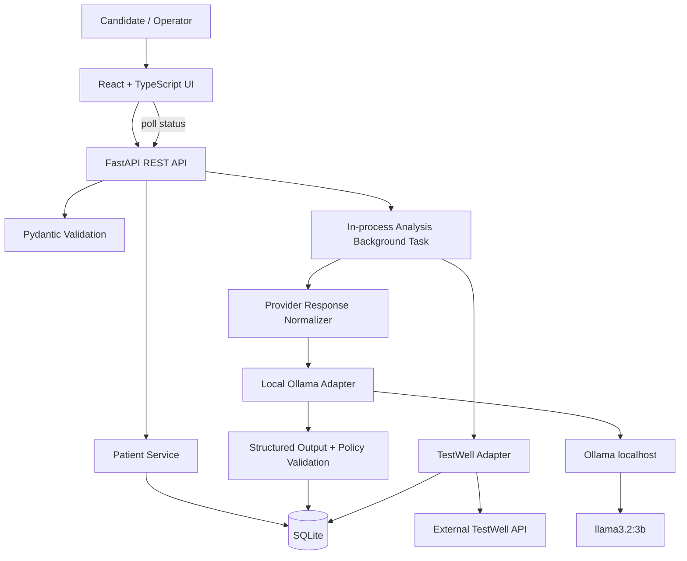
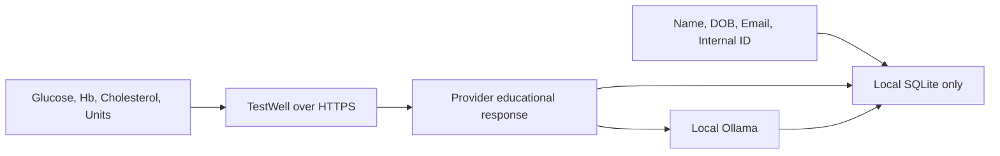

# System Architecture

**Version:** 0.2 — Owner-approved implementation baseline

## 1. Architectural style

Use a **modular monolith**: one Python backend, one local SQLite database and one React frontend. This is sufficient for a single-user assessment application. Do not introduce microservices, Redis, Celery, Kubernetes or cloud infrastructure.

## 2. High-level component diagram

## 3. Responsibilities

### Frontend
- Collect and display the required fields.
- Explain date/email/numeric validation.
- Show unit assumption and external data disclosure before the first API transmission.
- Display duplicate warning and confirmation.
- Poll the record/analysis status.
- Render the provider-returned observations and source citations separately from the local AI-generated remark.
- Show whether a remark is AI-generated, deterministic fallback or unavailable.

### FastAPI layer
- Own request/response contracts.
- Validate and normalize input.
- Perform CRUD operations.
- Create durable analysis-run records.
- Schedule the in-process analysis function.
- Return status without waiting for external calls/model inference.
- Expose health/readiness endpoints.

### Domain services
- `PatientService`: persistence and duplicate behaviour.
- `AnalysisOrchestrator`: create an analysis run, call provider, normalize response, generate local remark, persist status.
- `TestWellClient`: external HTTPS adapter.
- `TestWellNormalizer`: validate/normalize provider JSON.
- `OllamaRemarksGenerator`: local model adapter.
- `RemarksPolicyValidator`: validates schema, output size, signal references and safety constraints.
- `AssessmentUnitProfile`: explicit configured unit assumptions; not inferred from numbers.

### Persistence
- `patients`: current contact and blood-test data.
- `patient_analyses`: append-only analysis runs and provenance snapshots.

## 4. Analysis lifecycle

Create and analysis are separate operations.

1. API validates request and checks duplicate fingerprint.
2. One short DB transaction inserts the patient and initial `patient_analyses` row with `PENDING`; commit.
3. API returns `201 Created` with patient ID and `analysis_status=PENDING`.
4. A synchronous callable is registered with FastAPI `BackgroundTasks`. It runs in Starlette's worker thread pool. The callable uses bounded synchronous HTTP clients for TestWell and local Ollama; no network/model call is made while a database transaction is open.
5. The worker loads an immutable numeric/unit snapshot from `patient_analyses`.
6. TestWell receives only analyte name, numeric value and unit.
7. The normalizer validates response shape, marker matches, unit mismatch, flag and range qualifier.
8. Ollama receives only normalized provider facts and missing-context caveats, not patient identity fields.
9. The worker validates the structured model response and persists the result in a second short transaction.
10. Frontend polls `GET /patients/{id}` or `GET /patients/{id}/analyses/{analysis_id}`.

FastAPI documents `BackgroundTasks` for work performed after returning a response, while suggesting a separate job system for heavy computation. This assessment uses the in-process mechanism because it is a small single-user prototype, not a production queue. See [FastAPI Background Tasks](https://fastapi.tiangolo.com/tutorial/background-tasks/).

### Background-task limitations

- In-process tasks are not durable across process termination.
- No claim of production job reliability.
- On startup, any analysis left `PENDING` by an interrupted run must be transitioned to `FAILED` with a retryable `PROCESS_INTERRUPTED` error; do not silently mark it completed.
- Manual retry creates a new analysis row, preserving the prior run.
- Use one Uvicorn worker for local SQLite assessment execution.

## 5. Non-blocking and transaction rules

- Use normal `def` endpoints for synchronous SQLAlchemy operations; FastAPI runs synchronous path functions in a worker thread pool.
- The analysis background callable is also synchronous and performs bounded blocking I/O in the worker pool, not on the ASGI event loop.
- Do not call blocking `requests`/Ollama SDK operations directly from `async def`.
- Keep transactions short: commit before outbound I/O; create a new session for final updates.
- Configure finite connect/read timeouts from settings and test them. Initial proposed values: TestWell connect 3s/read 8s; Ollama connect 2s/read 20s. Adjust only using measured evidence.
- If all worker capacity is exhausted, report pending status; never freeze the whole app by doing model inference inline in the request handler.

## 6. PATCH behaviour

- Name/email-only update: persist; do not create a new analysis run.
- DOB or measurement update: persist new current values and create a new `PENDING` analysis run with a fresh immutable snapshot.
- Previous analysis history remains available.
- If the new analysis fails, the patient update remains saved; latest analysis is `FAILED` or `DEGRADED`; previous completed analysis remains in history and is labelled as based on older values.

## 7. External-data and AI privacy boundaries

Only measurement values, analyte labels and the explicit unit profile are transmitted to TestWell. Names, emails, DOB, patient IDs and raw form payloads must not be sent. The local model runs on `127.0.0.1`; no hosted generative LLM is part of v0.2.

Before first transmission, the operator must acknowledge this data flow. Provider statements about not logging result values remain third-party claims and are not independently verified by this project.

## 8. Failure modes

- TestWell unavailable, HTTP error, timeout, rate limit or malformed response: persist provider failure; no fabricated flag.
- Marker not found or unit mismatch: record `NO_MATCH`/`CONTEXT_LIMITED`; do not interpret as normal.
- Range qualifier requires missing fasting/sex/age context: show provider flag with explicit qualifier and mark applicability limited.
- Ollama unavailable, timeout, malformed JSON or safety validation failure: deterministic fallback labelled `FALLBACK`; never `AI_GENERATED`.
- Database update failure after an external response: record error where possible and allow retry; external response may be lost, so no claim of exactly-once provider execution.

## 9. Deployment topology

Local development:
- Browser: Vite development server.
- API: one local Uvicorn process.
- Database: file-backed SQLite.
- Ollama: local service on `127.0.0.1:11434`.
- TestWell: outbound HTTPS only.

No deployment or cloud hosting is required.
